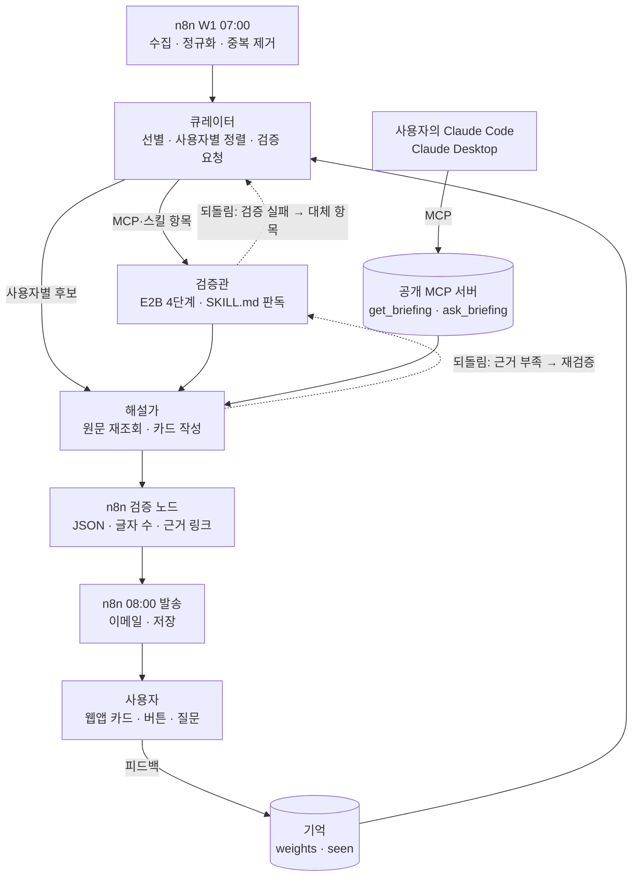

# toolscout

매일 아침 8시, AI 소식과 새 MCP·스킬을 내 상황 기준으로 골라 한글로 해설하는 개인 에이전트.

A personal agent that picks AI news and new MCP servers and skills for you every morning, then explains them in Korean.


> 현재 상태: 0단계 준비와 1단계 뼈대 앞부분 진행 중. 진행 이력은 [CHANGELOG.md](CHANGELOG.md)를 본다.

## 📬 무엇을 하나

소스 12곳에서 하루 약 140건을 모아, 사용자마다 볼 만한 5건과 새 도구 3건을 고르고 해설한다. 새 MCP는 샌드박스에서 직접 설치해 보고, 새 스킬은 원문을 읽어 위험 신호를 표시한다.

아침 브리핑 예시 (내용은 설명용 가상 항목):

```text
2026-09-14 (월) 08:00 · toolscout 아침 브리핑 · 백엔드 개발자, 쓰는 도구: n8n

[뉴스] 오픈소스 에이전트 프레임워크 X 2.0 출시, 도구 호출 병렬 실행 지원
  요약       도구 여러 개를 한 번에 부르고 결과를 모아 다음 단계로 넘기는 기능이 들어갔다.
  나한테는    n8n에서 순서대로 걸던 HTTP 노드 3개를 한 번의 호출로 묶어 볼 수 있다.
  왜 이 카드?  관심 주제 '에이전트 프레임워크' 가중치 +3, 어제 비슷한 카드에 '써봤음'
  함께 보도   긱뉴스, 해커뉴스
  [관심없음] [써봤음] [이상함]                              trace 7f3a...c21e

[MCP] @example/notion-mcp  v1.4.0 · 공식 레지스트리 · 3일 전 등록
  요약       노션 페이지 검색, 읽기, 블록 추가를 MCP 도구로 제공한다.
  나한테는    회의록을 노션에 쌓는 n8n 워크플로우에서 HTTP 노드 대신 붙일 수 있다.
  장점       도구가 3개라 범위가 작다 (근거: 저장소 README)
  단점       쓰기 권한 토큰이 필요하다 (근거: 레지스트리 항목)
  직접 깔아봤더니 (E2B 샌드박스, 동작 확인일 뿐 기능 보증 아님)
    ① 설치       ○  9초
    ② 실행       ○
    ③ 도구 목록   ○  3개 (search_pages, read_page, append_block)
    ④ 인증       필요  NOTION_TOKEN
  설치 명령   npx -y @example/notion-mcp
  [관심없음] [써봤음] [이상함]                              trace 2b91...e04d
```

## 🤔 왜 만들었나

1. AI 에이전트 개발자에게 동향 파악은 직무 요건이다. 모르면 낡은 도구로 만들고, 있는 걸 다시 짜고, 면접에서 답을 못 한다.
2. 소스 8곳만 모아도 하루 약 140건이라 다 볼 수 없다.
3. 뉴스는 "나왔다"까지만 말하고 "나에게 왜 중요한지, 언제 쓰는지"는 말하지 않는다.
4. 새 도구 소개글은 써보지 않은 추측이고, 커뮤니티 스킬은 검수 없이 올라온다.
5. 그래서 더 많은 뉴스가 아니라, 140건 중 내게 필요한 5건을 골라 내 상황 기준으로 해설하고 도구는 실제로 확인해서 준다.

## 🔄 어떻게 동작하나



- 자동화(n8n): 07:00 수집, 정규화, 중복 제거, 검증 노드, 08:00 발송. 정해진 시간에 무조건 돈다.
- 자율(에이전트): 오늘 몇 건 낼지, 비울지, 어디까지 검증할지, 카드를 반려할지. 결정마다 이유가 트레이스에 남는다.

## 🤖 에이전트 3개

세 에이전트는 같은 루프(`agent/loop.py`)를 쓰고 프롬프트, 허용 도구, 모델만 다르다.

| 에이전트 | 역할 | 모델 (기본 / 대체) | 스스로 정하는 것 |
|---|---|---|---|
| 큐레이터 | 140건 중 오늘 볼 것을 고르고 사용자별로 정렬, 검증할 도구 항목 선정 | Gemini 3.6 Flash 유료 / Claude Haiku 4.5 | 몇 건 낼지, 카드를 비울지, 어느 항목을 얼마나 깊이 검증할지 |
| 검증관 | MCP는 샌드박스 4단계 검증, 스킬은 원문 판독과 위험 신호 분석 | Claude Opus 5 / Claude Sonnet 5 | 설치 명령을 어디서 뽑을지, 원격 전용인지, 도구 목록 조회까지 갈지, "확인 필요"로 멈출지 |
| 해설가 | 사용자별 요약, "나한테는", 장단점 작성 | Claude Sonnet 5 / GPT-5.6 Terra | 원문을 읽을지, 근거가 부족하면 재검증을 요청할지, "나한테는"이 안 서면 카드를 반려할지 |

## 🧰 기술 스택

| 구성 | 선택 | 이유 |
|---|---|---|
| 서버 | Python 3.12, FastAPI | 에이전트 서버, MCP 서버, 웹앱을 한 앱에 올린다 |
| MCP | `mcp` SDK 2.x (`MCPServer`, streamable HTTP) | 에이전트, n8n, 사용자의 Claude Code가 같은 도구를 프로토콜로 공유한다 |
| LLM | Anthropic, Gemini 유료, OpenAI(대체) | 선별·검증·해설은 비용과 실패 비용이 달라 역할마다 모델을 나눈다. 전부 학습 미사용 요금제 |
| 루프 | `agent/loop.py` 직접 구현 + `langchain-core` | 판단 루프는 직접 짜고, core에서는 도구 스키마와 메시지 형식만 빌린다 |
| 자동화 | n8n | 시간, 순서, 재시도, 발송만 맡긴다 |
| DB | SQLModel, Supabase(Postgres) | 개발과 운영 모두 Supabase 하나, 연결은 `DATABASE_URL` |
| 동작 검증 | E2B | 관리형 호스팅에서 도커 안 도커가 안 되므로 외부 마이크로 VM을 쓴다 |
| 트레이싱 | Langfuse | 브리핑 1회가 트레이스 1개, 카드마다 `trace_id` |
| 수집 | httpx, feedparser | RSS와 공개 API, 전부 무료 |
| 화면 | 정적 HTML·JS | 프레임워크 없이 FastAPI가 서빙한다 |
| 배포 | Docker Compose(로컬), Railway(운영) | 컨테이너 2개(n8n, app) |

쓰지 않는 것:

- RAG: 핵심 데이터가 오늘 소식과 오늘 등록된 도구라 최신성이 중요해서 매번 원문을 실시간 조회하고, 쌓인 데이터는 DB 키워드 검색으로 찾는다.
- LangChain: 메타 패키지는 langgraph를 의존으로 끌어오므로 설치하지 않고 `langchain-core`만 쓴다.
- LangGraph: 루프, 도구 호출, 재시도, 되돌림을 직접 짜야 에이전트의 판단 지점을 코드와 트레이스에서 바로 짚을 수 있다.

## 🚀 빠른 시작

뼈대 완성 전이라 4단계의 브리핑 생성은 아직 동작하지 않는다.

1. 환경 파일 복사: `cp .env.example .env`
2. `.env`에 키 채우기: `DATABASE_URL`(Supabase), `ANTHROPIC_API_KEY`, `GEMINI_API_KEY`, `GMAIL_USER`, `GMAIL_APP_PASSWORD`, `MCP_SERVICE_KEY` 등
3. 실행: `docker compose up -d` (로컬 Langfuse까지 띄우려면 `docker compose --profile langfuse up -d`)
4. 첫 브리핑 확인: `http://localhost:8000` 접속, 받은 메일의 카드마다 `trace_id`가 있는지 확인

## 🔌 내 브리핑을 Claude Code에서 쓰기

웹앱 설정에서 MCP 키를 발급받아 Claude Code의 `.mcp.json`에 넣는다. 공개 도구는 읽기 전용이고 본인 브리핑만 조회한다.

```json
{
  "mcpServers": {
    "toolscout": {
      "type": "http",
      "url": "https://<배포 주소>/mcp",
      "headers": {
        "Authorization": "Bearer <설정에서 발급한 MCP 키>"
      }
    }
  }
}
```

연결 후 Claude Code에서 "오늘 브리핑에서 n8n 관련 MCP 있어?"라고 물으면 `ask_briefing`이 불린다.

## 📁 프로젝트 구조

```text
toolscout/
├── main.py              FastAPI 앱 (/ 화면, /api/ 기능, /mcp MCP 서버)
├── mcp_server.py        자체 MCP 서버 (내부 도구 6종, 공개 도구 3종 예정)
├── models.py            역할별 기본/대체 모델표와 call()
├── providers.py         공급자별 호출 (Anthropic, Gemini, OpenAI 호환)
├── db.py                SQLModel 데이터 표 9개 (Supabase)
├── config.py            .env 로더 (값은 출력하지 않음)
├── events.py, gate.py, memory.py
├── agent/               loop.py, tracing.py, curator.py, verifier.py, explainer.py
├── sources/             소스별 수집 파서
├── pipeline/            normalize.py, dedupe.py, validate.py, persist.py, run_daily.py, deliver.py, briefing_mail.py
├── routes/              웹앱 화면·API 라우터
├── web/                 정적 HTML·JS
├── mcp/                 공개 MCP 설정 예시, E2B 안 tools/list 스크립트
├── n8n/workflows/       W0~W4 워크플로우 JSON
├── tests/               기능별 검수 스크립트
├── docs/                계획안.md, local-model.md, img/
├── .github/workflows/   CI (Docker 구성 검사)
├── docker-compose.yml
└── Dockerfile
```

## 📊 품질 지표

| 기준 | 목표 | 실측 | 근거 (예정) |
|---|---|---|---|
| 선별 재현율·정밀도 | 하루치 정답 20건(AI 관련·볼 만함) 기준 각 90% 이상 | 측정예정 | `golden/select_*.json` |
| 검증 4단계 정확도 | 수동 확인 10건과 단계별 일치 90% | 측정예정 | `golden/probe_*.json` |
| "나한테는" 프로필 적합률 | 80% 이상 (골든셋 40건, 채점자 2명 + 심판 GPT, 일치율 병기) | 측정예정 | `golden/results_*.json` |
| 에이전트 되돌림 | 트레이스에 되돌림 스팬 1건 이상, 대체 항목 선택 확인 | 측정예정 | Langfuse |
| 공개 MCP | Claude Code에서 `ask_briefing` 호출 성공, 다른 사용자 키로 거부 | 측정예정 | 스크린 기록 |
| 스킬 위험 신호 일치율 | 10건 중 8건 | 측정예정 | 같음 |
| 인젝션 방어 | 테스트 스킬 5개에 지시 문장 삽입 시 판정 불변 5/5 | 측정예정 | 같음 |
| 발송 성공률 | 7일 연속 100% | 측정예정 | briefings.sent_at |
| 카드당 트레이스 | 100% | 측정예정 | Langfuse |
| 브리핑 열람률 | 기록·공개 (목표치 없음) | 측정예정 | 링크 클릭 |
| 검증 4단계별 성공률 | 기록·공개 | 측정예정 | probes |
| 반 사용자 7일 유지율 | 기록·공개 | 측정예정 | seen |
| 소스 연결 | 무료 13개 OK | 측정예정 | `tests/sources/report.md` |
| langgraph 미설치, langchain-core만 설치 | `pip check` 통과, langgraph import 실패, langchain-core 의존에 langgraph 없음 | 측정예정 | `tests/env/check_env.json` |

골든셋 40건 기준 95% 신뢰구간은 약 ±12%p라서 대규모 품질 보증으로 해석하지 않는다.

## 📸 스크린샷

촬영 후 아래 파일명으로 `docs/img/`에 넣는다.

| 장면 | 파일 |
|---|---|
| 웹앱 카드 화면 | `docs/img/web_cards.png` |
| 에이전트 작업 창 | `docs/img/agent_panel.png` |
| Langfuse 트레이스 | `docs/img/langfuse_trace.png` |
| Claude Code에서 `ask_briefing` 호출 | `docs/img/claude_code_mcp.png` |

## 📄 라이선스와 문서

- 라이선스: MIT
- 설계 문서: [docs/계획안.md](docs/계획안.md)
- 작성자: (작성자 이름)
