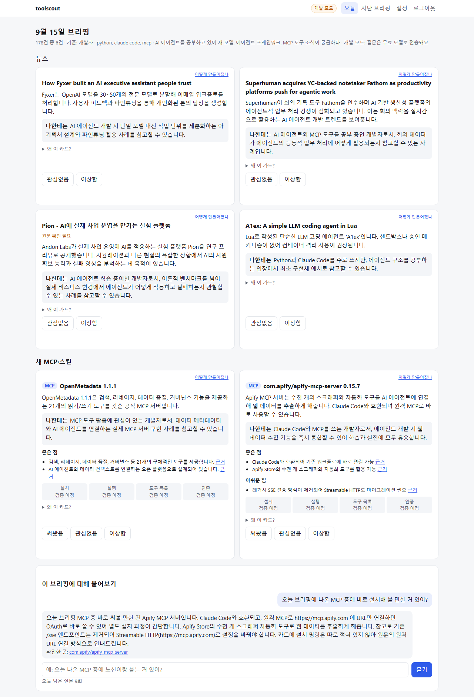
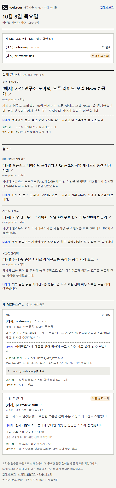

# toolscout

매일 아침 8시, AI 소식과 새 MCP·스킬을 내 상황 기준으로 골라 한글로 해설하는 개인 에이전트.

A personal agent that picks AI news and new MCP servers and skills for you every morning, then explains them in Korean.


> 현재 상태: 2026-09-17부터 매일 아침 발송 운영 중. 진행 이력은 [CHANGELOG.md](CHANGELOG.md)를 본다.

## 📬 무엇을 하나

소스 20곳에서 하루 약 140건을 모아, 사용자마다 별점(중요도) 높은 뉴스 최대 10건(오늘의 큰 소식 포함)과 새 도구 3건을 고르고 해설한다. 새 MCP는 샌드박스에서 직접 설치해 보고, 새 스킬은 원문을 읽어 위험 신호를 표시한다.

아침 브리핑 예시 (내용은 설명용 가상 항목):

```text
2026-09-14 (월) 08:00 · toolscout 아침 브리핑 · 백엔드 개발자, 쓰는 도구: n8n

[뉴스] 오픈소스 에이전트 프레임워크 X 2.0 출시, 도구 호출 병렬 실행 지원
  요약       도구 여러 개를 한 번에 부르고 결과를 모아 다음 단계로 넘기는 기능이 들어갔다.
  나한테는    n8n에서 순서대로 걸던 HTTP 노드 3개를 한 번의 호출로 묶어 볼 수 있다.
  왜 이 카드?  관심 주제 '에이전트 프레임워크' 가중치 +3, 어제 비슷한 카드에 '써봤음'
  함께 보도   긱뉴스, 해커뉴스
  [관심없음] [써봤음] [이상함]                              trace 7f3a...c21e

[MCP] @example/notion-mcp  v1.4.0 · 공식 레지스트리 · 3일 전 등록
  요약       노션 페이지 검색, 읽기, 블록 추가를 MCP 도구로 제공한다.
  나한테는    회의록을 노션에 쌓는 n8n 워크플로우에서 HTTP 노드 대신 붙일 수 있다.
  장점       도구가 3개라 범위가 작다 (근거: 저장소 README)
  단점       쓰기 권한 토큰이 필요하다 (근거: 레지스트리 항목)
  직접 깔아봤더니 (E2B 샌드박스, 동작 확인일 뿐 기능 보증 아님)
    ① 설치       ○  9초
    ② 실행       ○
    ③ 도구 목록   ○  3개 (search_pages, read_page, append_block)
    ④ 인증       필요  NOTION_TOKEN
  설치 명령   npx -y @example/notion-mcp
  [관심없음] [써봤음] [이상함]                              trace 2b91...e04d
```

## 🤔 왜 만들었나

1. AI 에이전트 개발자에게 동향 파악은 직무 요건이다. 모르면 낡은 도구로 만들고, 있는 걸 다시 짜고, 면접에서 답을 못 한다.
2. 소스 8곳만 모아도 하루 약 140건이라 다 볼 수 없다.
3. 뉴스는 "나왔다"까지만 말하고 "나에게 왜 중요한지, 언제 쓰는지"는 말하지 않는다.
4. 새 도구 소개글은 써보지 않은 추측이고, 커뮤니티 스킬은 검수 없이 올라온다.
5. 그래서 더 많은 뉴스가 아니라, 140건 중 의미 있는 10건 안쪽을 골라 내 상황 기준으로 해설하고 도구는 실제로 확인해서 준다.

## 🔄 어떻게 동작하나


- 자동화(앱 안 예약): 07:00 수집, 정규화, 중복 제거, 검증 노드, 08:00 발송. 정해진 시간에 무조건 돈다.
- 자율(에이전트): 오늘 몇 건 낼지, 비울지, 어디까지 검증할지, 카드를 반려할지. 결정마다 이유가 트레이스에 남는다.

## 🤖 에이전트 3개

세 에이전트는 같은 루프(`agent/loop.py`)를 쓰고 프롬프트, 허용 도구, 모델만 다르다.

| 에이전트 | 역할 | 운영 모델 (기본 / 대체, 2026-10-11부터) | 스스로 정하는 것 |
|---|---|---|---|
| 큐레이터 | 140건 중 오늘 볼 것을 고르고 사용자별로 정렬, 검증할 도구 항목 선정 | Claude Haiku 5.5 / gpt-4o-mini | 몇 건 낼지, 카드를 비울지, 어느 항목을 얼마나 깊이 검증할지 |
| 검증관 | MCP는 샌드박스 4단계 검증, 스킬은 원문 판독과 위험 신호 분석 | Claude Haiku 5.5 / gpt-4o-mini | 설치 명령을 어디서 뽑을지, 원격 전용인지, 도구 목록 조회까지 갈지, "확인 필요"로 멈출지 |
| 해설가 | 사용자별 요약, "나한테는", 장단점 작성 | Claude Haiku 5.5 / gpt-4o-mini | 원문을 읽을지, 근거가 부족하면 재검증을 요청할지, "나한테는"이 안 서면 카드를 반려할지 |

## 🧰 기술 스택

| 구성 | 선택 | 이유 |
|---|---|---|
| 서버 | Python 3.12, FastAPI | 에이전트 서버, MCP 서버, 웹앱을 한 앱에 올린다 |
| MCP | `mcp` SDK 2.x (`MCPServer`, streamable HTTP) | 에이전트와 사용자의 Claude Code가 같은 도구를 프로토콜로 공유한다 |
| LLM | Anthropic, Gemini 유료, OpenAI(대체) | 선별·검증·해설은 비용과 실패 비용이 달라 역할마다 모델을 나눈다. 전부 학습 미사용 요금제 |
| 루프 | `agent/loop.py` 직접 구현 + `langchain-core` | 판단 루프는 직접 짜고, core에서는 도구 스키마와 메시지 형식만 빌린다 |
| 자동화 | 앱 안 예약 (`pipeline/scheduler.py`) | 07:00 실행, 08:00 발송, 재시도. 워크플로 도구를 따로 띄우지 않는다 |
| DB | SQLModel, Supabase(Postgres) | 개발과 운영 모두 Supabase 하나, 연결은 `DATABASE_URL` |
| 동작 검증 | E2B | 관리형 호스팅에서 도커 안 도커가 안 되므로 외부 마이크로 VM을 쓴다 |
| 트레이싱 | Langfuse | 브리핑 1회가 트레이스 1개, 카드마다 `trace_id` |
| 수집 | httpx, feedparser | RSS와 공개 API, 전부 무료 |
| 화면 | 정적 HTML·JS | 프레임워크 없이 FastAPI가 서빙한다. 디자인 기준은 `docs/design-reference.html`, 아이콘은 Lucide(ISC), 그림은 자체 제작(`docs/asset-licenses.md`) |
| 배포 | Vercel(웹), Railway(아침 크론), Docker Compose(로컬) | 자세한 구성은 `docs/deploy.md` |

쓰지 않는 것:

- RAG: 핵심 데이터가 오늘 소식과 오늘 등록된 도구라 최신성이 중요해서 매번 원문을 실시간 조회하고, 쌓인 데이터는 DB 키워드 검색으로 찾는다.
- LangChain: 메타 패키지는 langgraph를 의존으로 끌어오므로 설치하지 않고 `langchain-core`만 쓴다.
- LangGraph: 루프, 도구 호출, 재시도, 되돌림을 직접 짜야 에이전트의 판단 지점을 코드와 트레이스에서 바로 짚을 수 있다.

## 🚀 빠른 시작

1. 환경 파일 복사: `cp .env.example .env`
2. `.env`에 키 채우기: `DATABASE_URL`(Supabase), `ANTHROPIC_API_KEY`, `GEMINI_API_KEY`, `GMAIL_USER`, `GMAIL_APP_PASSWORD`, `MCP_SERVICE_KEY` 등
3. 실행: `uv run uvicorn main:app --port 8000` 또는 `docker compose up -d`. 앱이 떠 있는 동안 07:00·08:00 예약이 돈다
4. 첫 브리핑 확인: `http://localhost:8000` 접속, 받은 메일의 카드마다 `trace_id`가 있는지 확인

## 🔌 내 브리핑을 Claude Code에서 쓰기

웹앱 설정에서 MCP 키를 발급받아 Claude Code의 `.mcp.json`에 넣는다. 공개 도구는 읽기 전용이고 본인 브리핑만 조회한다.

```json
{
  "mcpServers": {
    "toolscout": {
      "type": "http",
      "url": "https://<배포 주소>/mcp",
      "headers": {
        "Authorization": "Bearer <설정에서 발급한 MCP 키>"
      }
    }
  }
}
```

연결 후 Claude Code에서 "오늘 브리핑에서 n8n 관련 MCP 있어?"라고 물으면 `ask_briefing`이 불린다.

## 📁 프로젝트 구조

```text
toolscout/
├── main.py              FastAPI 앱 (/ 화면, /api/ 기능, /mcp MCP 서버)
├── mcp_server.py        자체 MCP 서버 (내부 도구 6종, 공개 도구 3종 예정)
├── models.py            역할별 기본/대체 모델표와 call()
├── providers.py         공급자별 호출 (Anthropic, Gemini, OpenAI 호환)
├── db.py                SQLModel 데이터 표 9개 (Supabase)
├── config.py            .env 로더 (값은 출력하지 않음)
├── events.py, gate.py, memory.py
├── agent/               loop.py, tracing.py, curator.py, verifier.py, explainer.py
├── sources/             소스별 수집 파서
├── pipeline/            normalize.py, dedupe.py, validate.py, persist.py, run_daily.py, deliver.py, briefing_mail.py
├── routes/              웹앱 화면·API 라우터
├── web/                 정적 HTML·JS
├── mcp/                 공개 MCP 설정 예시, E2B 안 tools/list 스크립트
├── tests/               기능별 검수 스크립트
├── docs/                계획안.md, local-model.md, img/
├── .github/workflows/   CI (Docker 구성 검사)
├── docker-compose.yml
└── Dockerfile
```

## 📊 품질 지표

| 기준 | 목표 | 실측 | 근거 |
|---|---|---|---|
| 선별 후보 재현율 (10/16부터) | 사람이 "볼 만함"으로 매긴 뉴스가 후보(AI 관련)에 드는 비율 90% 이상. 10/16 결정: 뉴스는 AI 관련이면 후보, 사용자별 뉴스는 별점 3 이상만 별점 순으로 큰 소식 포함 최대 10건 | 개발자가 블라인드로 매긴 10/3 156건(볼 만함 64건) 중 61건(95.3%)이 후보에 듦(같은 입력 Haiku 5.5 재판정, 후보 113건) | `tests/golden/human_select_2026-10-03.csv` |
| 선별 재현율·정밀도 (~10/16, 이전 기준) | 하루치 정답 20건(AI 관련·볼 만함) 기준 각 90% 이상 | 9/27 뉴스 141건(gemma3): 재현율 95.2%, 정밀도 63.2% / 9/30 189건(Claude Haiku): 재현율 87.5%, 정밀도 74.8% / 10/1 175건(기준 보강 뒤): 재현율 91.7%, 정밀도 78.6% / 10/2~10/4 498건: 재현율 85.3%, 정밀도 66.2% / 10/8~10/11 679건(제목 규칙 뒤): 재현율 90.0%, 정밀도 75.5%(일별 69~82%) / 10/16 선별 뉴스 기준·2차 검토 뒤 같은 입력 재판정(Haiku 5.5): 10/8~10/11 재현율 92.1%, 정밀도 93.1%, 기준에 안 쓴 10/2~10/4 재현율 88.0%, 정밀도 90.5% (채점 Claude Code, 10/8~10/11은 개발자 표본 40건 검토 일치 95%) | `tests/golden/select_*.json` |
| 검증 4단계 정확도 | 수동 확인 10건과 단계별 일치 90% | 측정예정 | `golden/probe_*.json` |
| "나한테는" 프로필 적합률 | 80% 이상 (골든셋 40건, 채점자 2명 + 심판 GPT, 일치율 병기) | 측정예정 | `golden/results_*.json` |
| 에이전트 되돌림 | 트레이스에 되돌림 스팬 1건 이상, 대체 항목 선택 확인 | 9/27~10/15 되돌림 13회 | briefings.run_stats.rollbacks, Langfuse |
| 공개 MCP | Claude Code에서 `ask_briefing` 호출 성공, 다른 사용자 키로 거부 | 이번 단계 제외(미구현) | `tests/web/check_rules.py` |
| 스킬 위험 신호 일치율 | 10건 중 8건 | 수동 대조는 측정예정. 판독 65건(정상 36·확인 필요 25·생략 3·주의 1), 정규식과 모델 판정 일치 37/58(64%) | skill_reviews |
| 인젝션 방어 | 테스트 스킬 5개에 지시 문장 삽입 시 판정 불변 5/5 | 판독 지시를 넣은 테스트 스킬도 외부 전송 판정 유지, 카드 인젝션 검사 18항목 통과, 실모델에 심은 공격 3건 유출 0, 실데이터 281건 중 지시 의심 1건(10/14) | `tests/verify/check_skill_read.py`, `tests/agent/check_injection.py` |
| 발송 성공률 | 7일 연속 100% | 9/17~10/15 29일 연속 발송, 그중 27일 08:00~08:04(9/28 08:24, 10/1 12:00 지연) | briefings.sent_at |
| 카드당 트레이스 | 100% | 보낸 카드 355장 중 355장 (10/15까지, 사용자 7명) | briefings.trace_id, Langfuse |
| 브리핑 열람률 | 기록·공개 (목표치 없음) | 측정예정 | 링크 클릭 |
| 검증 4단계별 성공률 | 기록·공개 | 샌드박스 확인 69건(9/15~10/15): 설치 44/49(90%), 실행 23/42(55%), 도구 목록 24/62(39%), 원격 20건 | probes |
| 반 사용자 7일 유지율 | 기록·공개 | 측정예정 | seen |
| 소스 연결 | 무료 13개 OK | 9/14 측정 9개 OK, 하루 수집 161건 | `tests/sources/report.md` |
| langgraph 미설치, langchain-core만 설치 | `pip check` 통과, langgraph import 실패, langchain-core 의존에 langgraph 없음 | 9/13 통과 | `tests/env/check_env.json` |

골든셋 40건 기준 95% 신뢰구간은 약 ±12%p라서 대규모 품질 보증으로 해석하지 않는다.

**선별 정답은 어떻게 만들었나**
- 정답 O/X는 Claude Code가 그날 선별 입력의 제목·출처만 보고 매겼다. 선별 모델의 판정은 가렸다(10/2~10/4·10/8~10/11 파일의 labeler 칸, 9/27~10/1은 가렸는지 기록 없음). 기준은 각 파일의 rubric 두 줄
- 10/8~10/11(679건) 정답은 Claude Opus 5.5(2026-10-16 작업 세션)가 매겼고, 선별 모델은 Claude Haiku 5.5다. 그 전 날짜 정답을 매긴 모델은 기록 없음
- 같은 세션이 이 정답의 오답 분석으로 10/16 선별 기준과 2차 검토 프롬프트를 썼다(2차 검토는 같은 날 B 결정으로 뺐다). 그래서 10/8~10/11 재판정 정밀도 93.1%는 기준을 맞춘 데이터의 값이고, 기준에 쓰지 않은 10/2~10/4(10/5 다른 세션이 매긴 정답)는 90.5%다
- 개발자 검토: 10/8~10/11 정답에서 날마다 Claude 정답 O 5건·X 5건을 무작위로 뽑은 40건을 개발자가 O/X로 판정했다. Claude 정답은 보이는 상태였고 선별 모델 판정은 없었다. 일치 38/40(95%, 95% 구간 83.5~98.6%, 카파 0.90). 다른 2건(llama.cpp Vulkan 벤치마크 모음, Lean 정리 증명기 글, 둘 다 Claude X·개발자 O)은 개발자 판정을 정답으로 했고, 같은 Lean 글의 한국어판도 O로 맞췄다(`tests/golden/review_select_2026-10-08_11.csv`)
- 사람 정답 하루치: 기준에 쓰지 않은 10/3 뉴스 156건 전체를 개발자가 매겼다. Claude 정답·모델 판정이 없는 무작위 순서 CSV였다(`tests/golden/human_select_2026-10-03.csv`). Claude 정답과 일치 146/156(93.6%, 카파 0.86), 다른 10건은 모두 개발자 O·Claude X(개발자 기준이 더 넓음)
  - 사람 정답 기준(156건, 사람 O 64건): 당시 운영 판정(Haiku 4.5) 정밀도 73.2%·재현율 81.2%, 이전 방식 재판정(Haiku 5.5) 76.7%·87.5%, **새 방식 재판정 정밀도 90.7%(49/54, 95% 구간 80.1~96.0%)·재현율 76.6%(49/64)**. 하루치라 구간이 넓고, 새 방식은 정밀도를 올린 만큼 재현율이 내려갔다
- 10/2 무작위 60건도 개발자가 매겼다(`tests/golden/human_select_2026-10-02_60.csv`, 영어 제목은 Claude Code가 한국어로 옮김). Claude 정답과 일치 44/60(73%, 카파 0.44). 출시 소식을 X로, 질문 글·인터뷰·고객 사례를 O로 매긴 것이 많아 "AI 관련이면 보고 싶다"는 기준 차이가 드러났고, 이것이 10/16 B 결정(뉴스는 AI 관련이면 후보, 별점 순)의 계기다
- 10/8~10/11은 사람이 679건 중 40건만 봐서 사람 정답만의 정밀도·재현율이 없다. 재판정(93.1%·90.5%)의 판정 결과 파일은 저장소에 없다(실험 출력은 로컬 임시 폴더)

### 개선 기록 (전후 실측)

| 항목 | 전 | 후 | 바꾼 것 |
|---|---|---|---|
| 원문을 못 읽어 "원문 확인 필요"로 나간 카드 | 10/11~10/14 30/99장(30%) | 10/15 2/42장(5%) | 레딧 글은 본문을 원문으로, 링크 글은 링크를 읽음(10/14) |
| 검증 노드에서 빠진 카드 | 10/11~10/14 32장 | 10/15 0장 | for_me가 여러 문장이면 첫 문장만 남기는 마지막 수단(10/14) |
| MCP 카드에 샌드박스 결과가 붙은 비율 | 9/16~9/26 5/24장(21%) | 9/27~10/14 41/65장(63%), 10/15 5/12장(42%) | 발송 전 샌드박스 확인(9/26). 한 실행 4건 한도라 사용자가 7명으로 는 10/15에 다시 낮아짐(열린 과제) |
| 디자인 채점(진행자 기준, 10점) | 1차 구현 7.5 | 2차 구현 8.6 | 디자인 회의 2라운드(10/15) |
| 아침 메일 길이(600폭, 예시 6장) | 3,324px | 2,510px(−24%) | 표 구조, 큰 소식 리드·뉴스 괘선 목록, 뉴스 장단점 뺌 |
| 예시 화면 폰 길이(390폭) | 3,531px | 3,330px(−6%) | 카드 세 무게, 폰 요약 접기 |
| 가장 낮은 글자 대비 | 메일 보조 글자 4.07:1(기준 미달) | 웹·메일 4.91:1 | 토큰 하나로 웹·메일 색 맞춤 |
| 자동 화면 검사 | 없음 | 16화면 × 라이트·자동 다크·수동 다크 × 1366·390·360 = 144조합 문제 0 | `tests/web/check_screens.py` |

## 📸 스크린샷

2026-10-15 2차 리디자인 뒤 화면. 오늘 화면은 개발자 본인 프로필의 10/14 실제 브리핑으로 찍었다(개발 모드라 DEV 표시).

| 장면 | 파일 |
|---|---|
| 오늘 브리핑 PC(라이트·다크) | `docs/img/web_cards.png`, `docs/img/today-desktop.png` |
| 오늘 브리핑 폰(라이트·다크) | `docs/img/web_today_phone.png`, `docs/img/today-mobile.png` |
| 지난 브리핑 폰 | `docs/img/web_history_phone.png` |
| 첫 화면(로그인) | `docs/img/web_login.png` |
| 아침 메일(600폭) | `docs/img/mail_morning.png` |
| 앱 설치 모드(폰) | `docs/img/pwa-standalone.png` |





## 📄 라이선스와 문서

- 라이선스: MIT
- 설계 문서: [docs/계획안.md](docs/계획안.md)
- 작성자: 김승욱
